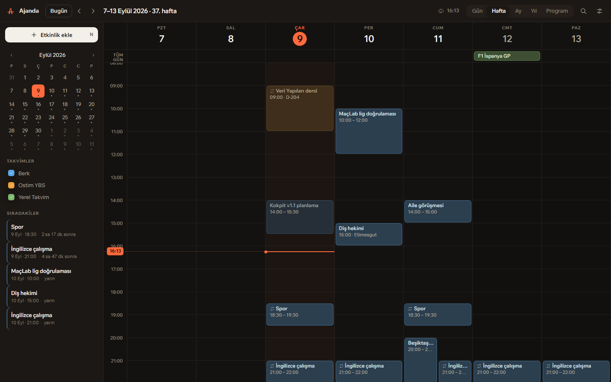
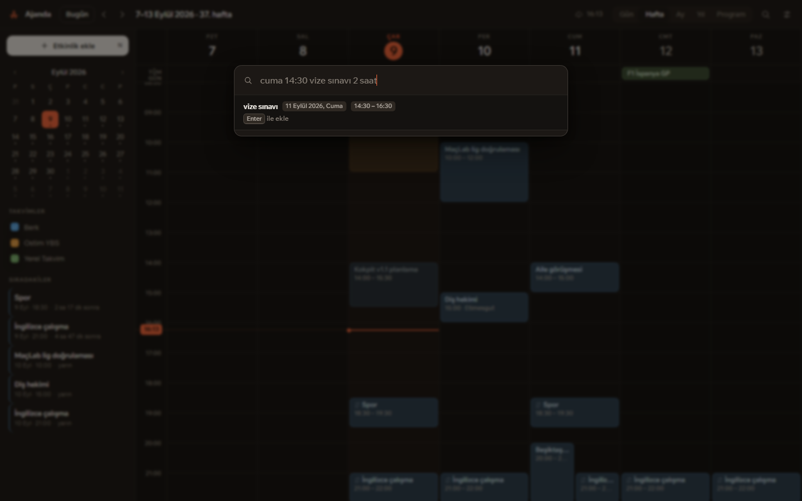
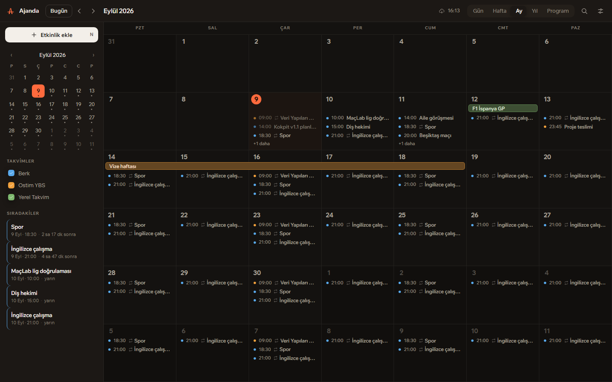
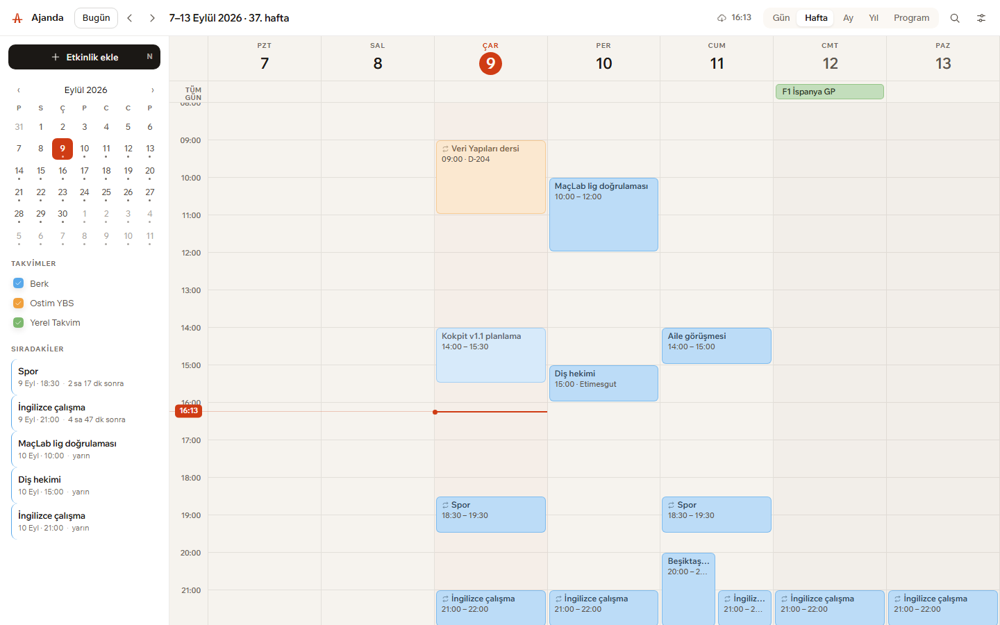

<div align="center">


# Ajanda

**Windows için kişisel takvim. Verisi sende kalır, Google Takvim ile çift yönlü senkron olur.**

[](https://github.com/berkdemir18/Ajanda/releases/latest)
[](LICENSE)
[](#kurulum)

[**İndir**](https://github.com/berkdemir18/Ajanda/releases/latest) · [Tanıtım sayfası](https://berkdemir18.github.io/Ajanda/) · [Google senkronu nasıl açılır](#google-takvim-senkronu)



</div>

---

## Ne yapar

Ajanda, takvimini **kendi bilgisayarında bir SQLite dosyasında** tutar ve
Google Takvim ile **çift yönlü** senkronlar. Telefonda eklediğin etkinlik
buraya, burada sürüklediğin blok oraya gider. İnternet yokken de tam çalışır;
bağlantı gelince bekleyen değişiklikler gönderilir.

Google'a hiç bağlanmasan da kullanılabilir — o zaman sadece yerel bir takvim olur.

## Öne çıkanlar

### Türkçe yazarak etkinlik ekle



`Ctrl+K` ile aç, cümleyi yaz, Enter'a bas:

| Yazdığın | Anladığı |
|---|---|
| `cuma 14:30 vize sınavı 2 saat` | 11 Eylül Cuma, 14:30–16:30 |
| `yarın 15:00 diş hekimi` | yarın 15:00–16:00 |
| `her salı 18:00 antrenman` | haftalık tekrar, salı 18:00 |
| `hafta içi 09:00 ders` | pazartesi–cuma tekrar |
| `12 eylül doğum günü` | 12 Eylül, tüm gün |
| `öbür gün akşam maç` | 2 gün sonra 20:00 |

Aynı kutu arama da yapar: iki harf yazdığın anda mevcut etkinliklerde arar,
ok tuşlarıyla gezip Enter ile açarsın.

### Beş görünüm

`Gün` · `Hafta` · `Ay` · `Yıl` · `Program`



Ay görünümünde çok günlü etkinlikler hafta sınırını aşan tek şerit olarak
çizilir — gün gün kopmaz. `Program` görünümü boş günleri atlar, sadece dolu
günleri sırayla yazar.

### Sürükleyerek düzenleme

Hafta ızgarasında boş alana sürükleyip etkinlik oluşturursun, bloğu tutup
başka güne/saate taşırsın, alt kenarından süreyi uzatırsın. Hepsi 15 dakikalık
adımlarla oturur.

### Kaynak ayrımı

Her takvim kendi rengini gövde, kenar ve başlıkta birden taşır — okul, kişisel
ve takip ettiğin takvimler lejant okumadan ayrılır. Google'dan gelen renkler
uygulamanın kendi paletine yaslanır, böylece ekranda iki komşu mavi durmaz.

### Açık ve koyu tema



### Ayrıca

- **Hatırlatıcılar** — Windows bildirimi olarak gelir, uygulama tepsideyken de çalışır
- **Tekrarlar** — günlük/haftalık/aylık/yıllık, "ayın 2. salısı" dahil (RRULE)
- **Tepsi simgesi** — kapatınca kapanmaz, tepsiye iner
- **Klavye** — `T` bugün, `←/→` gezinme, `N` yeni, `R` senkron, `1–5` görünüm, `Ctrl+K` palet
- **"Yapıldı" işareti** — yalnızca sende kalır, Google'a gitmez

## Kurulum

1. [**Ajanda_1.0.0_x64-setup.exe**](https://github.com/berkdemir18/Ajanda/releases/latest) dosyasını indir
2. Çift tıkla

Bu kadar. Yönetici yetkisi istemez, yalnızca kendi kullanıcına kurulur.
Masaüstüne ve Başlat menüsüne kısayol düşer. Kaldırmak istersen
Ayarlar → Uygulamalar → Ajanda.

> Windows SmartScreen "bilinmeyen yayımcı" uyarısı verebilir — kurulum imzalı
> değil. `Ek bilgi` → `Yine de çalıştır` ile geçebilirsin.

**Gereksinim:** Windows 10/11 (x64) ve WebView2. WebView2 Windows 11'de zaten
kuruludur; yoksa kurulum sırasında Microsoft'tan indirilir.

## Google Takvim senkronu

Ajanda kendi Google anahtarıyla gelmez — **kendi anahtarını kendin
oluşturursun.** Böylece verin üçüncü bir sunucudan geçmez; uygulama doğrudan
senin hesabınla konuşur. Beş dakikalık, tek seferlik bir iş:

1. [console.cloud.google.com](https://console.cloud.google.com) → yeni proje aç
2. **API'ler ve Hizmetler** → **Kitaplık** → `Google Calendar API` → **Etkinleştir**
3. **OAuth izin ekranı** → **Harici** → kendi e-postanı **Test kullanıcısı** olarak ekle
4. **Kimlik bilgileri** → **OAuth istemci kimliği oluştur** → tür: **Masaüstü uygulaması**
5. Çıkan **İstemci Kimliği** ve **İstemci Gizli Anahtarı**'nı Ajanda'da
   ⚙ **Ayarlar** → **Google Takvim** alanlarına yapıştır → **Google ile bağlan**

Tarayıcı açılır, izin verirsin, uygulamaya dönersin. Sonrası otomatik:
varsayılan olarak 5 dakikada bir arka planda senkron olur (Ayarlar'dan
değiştirilebilir), üst çubuktaki gösterge son senkron saatini ve bekleyen
değişiklik sayısını söyler.

Anahtarların yalnızca kendi bilgisayarındaki veritabanında durur, depoya veya
başka bir yere gitmez.

## Veriler nerede

```
%APPDATA%\com.berk.ajanda\ajanda.db
```

Tek bir SQLite dosyası. Yedeklemek istersen bu dosyayı kopyalaman yeterli.
Uygulama içinden Ayarlar → Veri bölümünde tam yolu görebilirsin.

## Kaynaktan derleme

Gereken: [Node.js](https://nodejs.org) 18+, [Rust](https://rustup.rs) ve
Visual Studio Build Tools (C++ masaüstü geliştirme).

```bash
git clone https://github.com/berkdemir18/Ajanda.git
cd Ajanda
npm install

npm run tauri dev      # geliştirme (gerçek veritabanı + Google)
npm run dev            # yalnız arayüz, sahte veriyle, tarayıcıda
npm run tauri build    # kurulum paketi → src-tauri/target/release/bundle/nsis/
```

`npm run dev` tarayıcıda açıldığında `src/core/mock.ts` devreye girer ve
uygulamayı sahte veriyle çalıştırır; üretim derlemesinde bu dosya elenir.

## Nasıl yapılmış

| Katman | Ne var |
|---|---|
| Kabuk | [Tauri v2](https://tauri.app) (Rust) — tepsi, bildirim, pencere |
| Veri | SQLite (`rusqlite`), WAL, tek dosya |
| Senkron | Google Calendar API v3, artımlı (`syncToken`), OAuth 2.0 PKCE + loopback |
| Arayüz | TypeScript + Vite — **çerçeve yok**, elle yazılmış CSS, çizilmiş SVG ikonlar |
| Yazı tipi | [Wix Madefor Text](https://github.com/wix/wixmadefor) (OFL), yerel paketli |

Renk sistemi, tipografi ölçeği, ızgara sabitleri ve marka geometrisi —
gerekçeleriyle birlikte — [`DESIGN.md`](DESIGN.md) dosyasında.

## Bilinen sınırlar

- Tekrarlı bir etkinliğin **tek bir gününü** düzenleyemezsin; düzenleme tüm
  seriyi etkiler. (Google'da tek gün değiştirilmiş etkinlikler doğru gösterilir.)
- "Yerel Takvim"deki kayıtlar Google'a gönderilmez — bu bilinçli.
- Hatırlatıcılar yalnız uygulama çalışırken (tepsideyken de) tetiklenir.
- Yalnız Windows. macOS/Linux denenmedi.
- **Google senkronu henüz canlı bir hesapla uzun süre denenmedi.** Kod artımlı
  senkronu, çakışmaları ve tekrar istisnalarını ele alacak şekilde yazıldı ama
  günlük kullanımda yıpratılmadı. Bir aksaklık görürsen
  [sorun bildir](https://github.com/berkdemir18/Ajanda/issues).

## Lisans

[MIT](LICENSE). Yazı tipi SIL OFL 1.1 ile gelir ([src/fonts/OFL.txt](src/fonts/OFL.txt)).

---

<div align="center">
<sub>Berk Demir tarafından, yapay zekâ ile birlikte geliştirildi.</sub>
</div>
